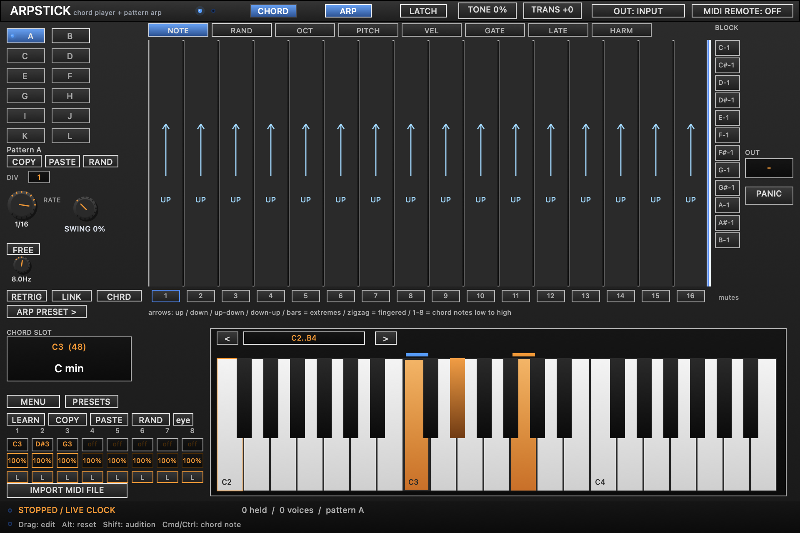

# Arp Stick



A **CLAP MIDI effect** written in **Zig 0.16.0**, with a native macOS editor. It is a feature-parity port of the JSFX `ArpStick.jsfx` project: a chord memorizer/player followed by a 12-pattern step arpeggiator. See [PARITY.md](PARITY.md) for the feature-by-feature mapping.

Play root notes and Arp Stick turns them into chords, arpeggios, or both. It produces MIDI; put a synth after it.

## What it does

### Chord module
- 128 chord slots (one per MIDI key), 8 voices per slot, per-voice velocity scaling 0–200%.
- Voice locks (pedal tones) that survive chord changes.
- Learn modes: record a chord and advance, learn one slot, advanced note-on learning with an 8 ms gap, and a 1-second timer learn.
- Global transpose ±36 semitones, MIDI latch, watched-slot filtering.
- Chord tools: six sort modes, duplicate removal, remove 1/2/3-note chords, remove unwatched, major↔minor/suspend transforms, note-prevent transform, match-selected-chord transform, populate empty slots, clear all.
- 56 chord presets: diatonic triads and sevenths in all 12 major keys and all 12 natural-minor keys, plus C I-V-vi-IV, Am i-VI-III-VII and G I-vi-IV-V progressions.
- MIDI-file import: chords are read from a `.mid` file into consecutive slots starting at the selected slot.

### Arp module
- 12 patterns (A–L), each with 8 lanes over 16 steps:
  - **NOTE** — chord-note selection, rests, numbered notes, up/down/up-down/down-up/bounce/fingered shapes, and reset arrows.
  - **RAND** — random note-selection offset.
  - **OCT** — octave transposition.
  - **PITCH** — scale/degree-aware pitch shifting with 7 enable buttons.
  - **VEL** — velocity scaling 0–200%.
  - **GATE** — step gate 0–100% (100% ties).
  - **LATE** — early/late step offset.
  - **HARM** — second relative note per step.
- Per-lane length (1–16) and clock division (1–8), optional link-length editing.
- Chord-inversion mode, per-step mutes, retrigger, swing (0–75%).
- Rate from 16 bars down to 1/2048, or a free clock from 0.05–40 Hz.
- Note-block keys per pitch class: pass, block, block-and-shift-up, block-and-shift-down.
- Tempo-synced to the host when playing, with automatic free-clock operation while stopped (matching the JSFX).
- Song-position seeking and transport start/stop handling.

### Global
- MIDI latch, output-channel routing (input or 1–16), MIDI remote on channels 2/3.
- Polyphonic saw test tone so you can audition without a synth.
- Non-note MIDI (CC, pitch bend, aftertouch, program change) passes through. CC120/123 panic.
- Full project save/restore of parameters, chord bank, patterns, names, locks, watch state and UI state.

## Editor

The native Cocoa editor mirrors the JSFX panel at 960 × 640 points and scales to the available view:

- Top bar: chord/arp bypass, latch, tone, transpose, output routing, MIDI remote.
- Pattern bank A–L with copy-by-drag, graph copy/paste/random, rate, swing, free clock, retrigger, link and chord modes.
- Eight lane tabs with draggable step graphs, mutes, reset arrows and the length marker.
- Chord slot display, voice note/velocity/lock strips, piano with note selection/toggling/auditioning, learn, chord copy/paste/random, watch, menus and presets.
- Status footer and panic.

### Work on the UI without a DAW

```sh
zig build preview
```

Opens a standalone 960 × 640 window with the same editor. The preview has a local parameter/pattern backend and produces no audio or MIDI. Command-Q quits. For automatic rebuilds (requires Python 3):

```sh
python3 scripts/preview-macos.py
```

The watcher reopens only the preview when a source file changes. Stop it with Ctrl-C.

## Build and install on macOS

Requires Zig 0.16.0 and Xcode command line tools. CLAP 1.2.9 headers are included; no framework download or C++ build is needed.

```sh
./scripts/install-macos.sh
```

This builds for your Mac's native architecture, ad-hoc signs the bundle, and copies it to `~/Library/Audio/Plug-Ins/CLAP/ArpStick.clap`.

For a development build only, run `zig build`. The bundle is at `zig-out/ArpStick.clap`. Restart REAPER after installing a new build so it unloads the previous library.

## Try it in REAPER

1. Restart REAPER or rescan plugins in **Preferences → Plug-ins → LV2/CLAP**. Search the FX browser for **Arp Stick**.
2. Add a track. Insert **Arp Stick** first, then **ReaSynth** (or another MIDI synth) after it on the same track.
3. Drag `examples/roots.mid` onto that track and press Play. It contains four long root notes and produces repeating arpeggios by default.
4. Open Arp Stick's FX window to see the editor and edit the pattern. REAPER's **UI** button can switch to the host's generic parameter controls if desired.
5. For live playing, arm the track, choose your MIDI keyboard as input, and enable input monitoring.

Or load `examples/setup-demo.lua` through **Actions → Show action list → New action → Load ReaScript**, then run it. It creates a new project tab with Arp Stick, ReaSynth, and example notes.

Arp Stick produces MIDI and passes existing stereo audio through. It needs a downstream instrument to make sound. The original root notes are replaced with generated notes; do not enable an additional dry MIDI path around the effect.

